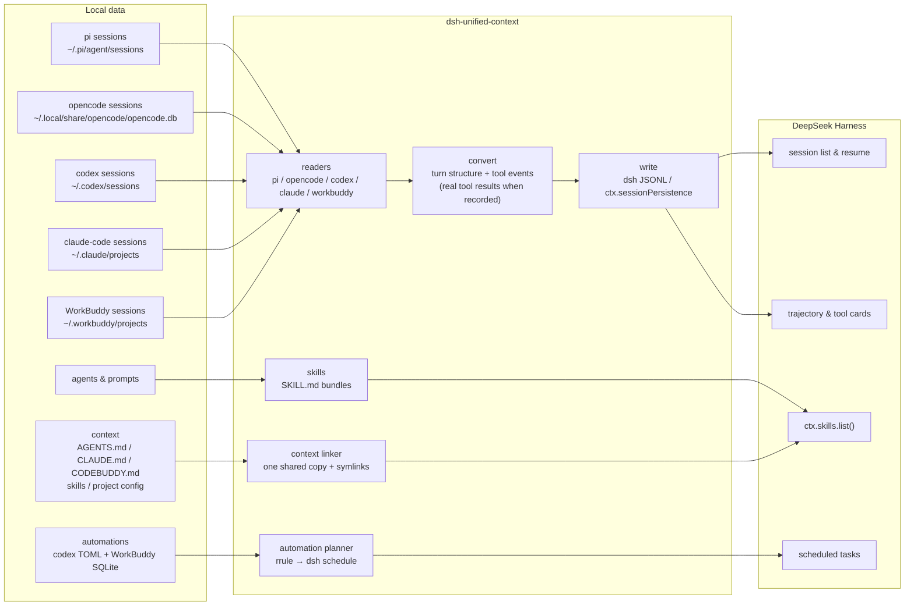

<!--
dsh-unified-context — released under the MIT License.
-->
# DSH Unified Context

**English** · [简体中文](README.zh.md)

[](LICENSE)
[](https://www.npmjs.com/package/dsh-unified-context)
[](https://github.com/Chang-Tong/dsh-unified-context/actions/workflows/ci.yml)
[](https://nodejs.org/)
[](https://dshoneys.github.io/awesome-dshoneys/)

**DSH Unified Context** (`dsh-unified-context`, 统一上下文) migrates **pi**, **opencode**, **codex**, **claude-code**, and **WorkBuddy (Tencent)** into [DeepSeek Harness](https://github.com/deepseek-ai/deepseek-harness) (dsh): sessions and chat history, the context the model actually saw (`AGENTS.md` / `CLAUDE.md` / `CODEBUDDY.md`, skills, project files), and scheduled automations. Context is **shared through symlinks — one real copy, every harness reading it — never copied per harness.** Sessions appear in the session list and resume with the full history; custom agents and mode prompts become discoverable dsh skills; a one-click **Sync** button in the composer runs the whole migration.

| Resource | Link |
| --- | --- |
| 中文文档 | [README.zh.md](README.zh.md) |
| npm package | [dsh-unified-context](https://www.npmjs.com/package/dsh-unified-context) |
| Source code | [github.com/Chang-Tong/dsh-unified-context](https://github.com/Chang-Tong/dsh-unified-context) |

## Table of Contents

- [Features](#features)
- [Screenshots](#screenshots)
- [Installation](#installation)
- [Usage](#usage)
- [How it works](#how-it-works)
- [Context parity](#context-parity)
- [Automations](#automations)
- [Configuration](#configuration)
- [Testing](#testing)
- [FAQ](#faq)
- [License](#license)

## Features

- **Five sources, one command.** Import sessions from pi (JSONL), opencode (SQLite), codex (JSONL), claude-code (JSONL), and WorkBuddy (JSONL) — as real, resumable dsh sessions.
- **Truly resumable.** Browse the full original history (text, reasoning, tool calls — and real tool results where the source recorded them) and continue the conversation; the model gets the complete context.
- **Context parity, not copies.** `/link-context` makes every harness read one shared `AGENTS.md`/`CLAUDE.md`/`CODEBUDDY.md` and one shared skill hub through symlinks: one real copy, no per-harness duplication, divergent copies reported instead of overwritten.
- **Automations migrate too.** Codex automations and WorkBuddy automations become dsh scheduled tasks (RRULE translated, imported paused by default so the source can be switched off first).
- **Agents become skills.** pi agents / mode prompts and opencode agents are converted into dsh skill bundles under `$DSH_AGENTS_HOME/skills`, with provenance recorded in frontmatter (`metadata.source` / `metadata.kind`).
- **One-click Sync button.** A small control in the composer tool row runs `/import-all` and shows the result inline — sessions, skills, context links, and paused automations.
- **Migration prompt on session start.** When a new top-level session starts and unimported history exists, the plugin asks whether to migrate — per-project decisions are remembered, so it never nags twice.
- **Workspace placement.** Imported sessions attach to a workspace matching their original `cwd` (created on demand); `/attach-workspaces` retro-fits existing imports.
- **Idempotent.** Stable ids (`pi-<uuid>` / `oc-<id>` / `codex-<id>` / `claude-<id>`); re-imports skip what already exists.
- **Zero runtime dependencies.** Node built-ins (`node:zlib` zstd, `node:sqlite`) plus dsh platform modules.

## Screenshots

> Taken from a clean Docker demo environment (English UI) with sample pi / codex sessions.

The dsh web UI with the **Sync** button in the composer tool row:


Clicking **Sync** runs the full import and shows the result inline:


Imported sessions land in a workspace matching their original project folder, with source-tagged titles (`[pi]`, `[opencode]`, `[codex]`, …):


An imported session opens like a native dsh session — text, reasoning, and tool calls are preserved, and you can keep talking:


Tool calls survive the import as real trajectory entries — the **Trajectory** tab renders a card per call (here a `bash` call from the imported codex session):


## Installation

The plugin is published on **npm** as `dsh-unified-context` and declares a `dsh.bundle`, so the official one-command installer activates it automatically. The previous `dsh-import-agents` package (0.3.1) remains available for old checkouts.

### One command (recommended)

```sh
dsh plugin --profile web add dsh-unified-context
```

`dsh plugin add` installs the package **and** appends it to the profile's bundle list (the layer is active — no manual config). Then restart `dsh web` and refresh the page.

> Every `pnpm` verb works through `dsh plugin --profile <name>` — e.g. `dsh plugin --profile web remove dsh-unified-context` uninstalls.

### Install sources (spec)

The `<spec>` argument is a standard pnpm package spec:

| Source | Command |
| --- | --- |
| npm (latest) | `dsh plugin --profile web add dsh-unified-context` |
| npm (exact / range) | `dsh plugin --profile web add dsh-unified-context@0.4.0` · `@^0.4` |
| GitHub (short) | `dsh plugin --profile web add github:Chang-Tong/dsh-unified-context` |
| GitHub (pinned commit) | `dsh plugin --profile web add github:Chang-Tong/dsh-unified-context#<sha>` |
| Git URL | `dsh plugin --profile web add git+https://github.com/Chang-Tong/dsh-unified-context.git` · `#v0.2.4` |
| Local checkout | `cd <checkout> && dsh plugin --profile web add .` or `file:/path/to/dsh-unified-context` |
| Dev link | `dsh plugin --profile web add link:/path/to/dsh-unified-context` |
| Tarball | `dsh plugin --profile web add ./dsh-unified-context-0.2.4.tgz` (or an `https://…` URL) |

Notes:

- Relative specs (`.`, `../plugin`, and their `file:` / `link:` forms) are anchored to the **invoking directory** — `add .` from a plugin checkout installs that checkout.
- Git-hosted plugins that build during install run their `prepare` script, which pnpm ≥ 10 blocks until allowed: the first `add` fails with an `allowBuilds` hint — copy the printed key into the profile's `pnpm-workspace.yaml` and re-run. Installing a **built tarball or a local checkout needs no allowance**.
- After every install, dependencies whose manifest declares `dsh.bundle` join the layer stack automatically; bundle-less packages install as plain dependencies (one-time warning).

### Restart and verify

1. Restart `dsh web` — the host plugin registers its slash commands at startup; the client bundle (the Sync button) is served automatically.
2. **Refresh the page** — the old page's RPC connection is gone after a restart.
3. Verify: the composer tool row shows the **Sync** button, and `/import-all` answers in the input.

```sh
# optional sanity checks
npm view dsh-unified-context version     # latest published version
pnpm list dsh-unified-context            # installed in the profile
```

> Disable the session-start migration prompt with `config: { offerOnStart: false }` on the inserted row. Source paths and defaults are overridable the same way — see [Configuration](#configuration).

## Usage

### Quick start

1. **Refresh the page** after a restart.
2. Click **Sync** in the composer tool row — or type `/import-all` in the input. This runs the complete migration: sessions from all five sources, agents → skills, shared context links, and paused automation tasks.
3. Imported sessions appear in the session list (grouped by workspace); imported agents appear as skills; the Automation tasks page shows the migrated tasks (**paused** — pause the source automation first, then resume it in dsh).

Everything is **idempotent** — run it as often as you like; already-imported sessions are skipped, existing links are reused, and identical automation tasks are not duplicated.

### Slash commands

| Command | What it does |
| --- | --- |
| `/import-pi [options]` | Import pi sessions |
| `/import-opencode [options]` | Import opencode sessions |
| `/import-codex [options]` | Import codex sessions |
| `/import-claude-code [options]` | Import claude-code sessions |
| `/import-workbuddy [options]` | Import WorkBuddy sessions |
| `/import-agents` | Convert pi/opencode agents & prompts into dsh skills |
| `/link-context [--project DIR] [--dry-run] [--push]` | Share one `AGENTS.md`/`CLAUDE.md`/`CODEBUDDY.md` + skill hub across harnesses with symlinks (never copies) |
| `/import-automations [--only id] [--activate] [--dry-run]` | Migrate Codex + WorkBuddy automations into dsh scheduled tasks (paused by default) |
| `/import-all [options]` | All of the above (5 session sources + agents + context links + paused automations) |
| `/attach-workspaces` | Attach imported sessions to cwd-matched workspaces (retro-fit) |

Options: `--limit N` · `--project <substr>` · `--since <iso|ms>` · `--no-tools` · `--tools-as-text` · `--tool-truncate N` · `--context-project DIR` · `--push` · `--activate`

### CLI (no dsh needed)

```sh
node import.mjs all                    # dry-run preview (writes nothing)
node import.mjs all --apply            # sessions + skills + shared context links
node import.mjs sessions codex --apply --limit 20        # one source at a time
node import.mjs sessions workbuddy --apply               # WorkBuddy sessions
node import.mjs agents --apply         # agents/prompts → skills only
node import.mjs context --apply        # share AGENTS.md/CLAUDE.md/CODEBUDDY.md + skills
node import.mjs context --push --apply # also link hub skills into every harness root
node import.mjs context --project-dir ~/work/app --apply # project-level unification
node import.mjs automations            # plan Codex/WorkBuddy automations (paused)
node export.mjs                        # export sessions as Markdown for any agent to read
```

- `import.mjs` defaults to **dry-run**; pass `--apply` to write.
- `all` = **five session sources + agents + context links** (with `--apply`) + the automation **plan**. Creating automation tasks needs the running host — use `/import-automations` in dsh.
- `context` links one shared copy instead of copying: no-op on re-runs, conflicts are reported and left untouched; `--push` opts into bidirectional skill parity.
- `export.mjs` writes `$DSH_HOME/exports/<source>/<session-id>.md` (`--source`, `--project`, `--limit`, `--since`, `--out`, `--no-reasoning`, `--no-tools`).

## How it works



The importer is a pure converter: `lib/` parses each source format into a normalized message stream, then emits the exact dsh JSONL event layout (checksummed zstd frames, project-dir encoding) — byte-for-byte the format the dsh persistence backend reads back with its own `list` / `load` / `prepare`.

**Sessions.** Each user message opens a turn (`turn/start` + `user/message`); following assistant messages join it with increasing step numbers; every turn closes with `turn/end`. pi `thinking` → dsh `reasoning` blocks. pi `toolCall`, opencode `tool`, claude `tool_use`, codex `tool_use`, WorkBuddy `function_call` → `tool-call` content blocks **plus paired `tool/call` + `tool/result` events**: the trajectory UI renders call cards, and the `tool/result` answers every `tool_calls` so OpenAI-compatible APIs accept resumed requests. WorkBuddy also stores the real result (`function_call_result`), which is preserved; the other formats only keep the call, so their `tool/result` carries a clearly marked placeholder. WorkBuddy's injected `<system-reminder>` context is stripped and only the actual `<user_query>` turn is imported. `--tools-as-text` switches to plain text (no trajectory cards); `--no-tools` drops tool calls. Mechanical records (`step-start`, `patch`, `compaction`, …) are skipped.

**Agents & prompts → skills.** Written to `$DSH_AGENTS_HOME/skills/<name>/SKILL.md` (default `~/.agents/skills/`), discoverable via `ctx.skills.list()`. Name conflicts are renamed `<name>-<source>` (e.g. `k3-reviewer-opencode`); existing bundles are only completed, never clobbered; identical content is skipped; frontmatter records `metadata.source` / `metadata.kind`.

**Context.** Instructions and skills are not converted; they are **linked** to one canonical copy (see [Context parity](#context-parity)). The migration never writes a second copy into a harness workspace.

**Automations.** Codex `automation.toml` files and WorkBuddy's automations SQLite database are planned into dsh scheduled tasks (see [Automations](#automations)).

## Context parity

Switching harnesses must not change what the model sees. The chat transcript is only one layer of context; the importer migrates the rest too — and does it by linking, not copying:

| Context layer | What it is | How the migration handles it |
| --- | --- | --- |
| Conversation | user/assistant messages, reasoning, tool calls, tool results | imported into dsh sessions (real results preserved where recorded) |
| Instructions | `AGENTS.md`, `CLAUDE.md`, `CODEBUDDY.md` — global and per project | one canonical file; every harness path is a symlink to it |
| Skills | `<name>/SKILL.md` bundles and flat `<name>.md` skills | one shared hub (`~/.agents/skills`); harness-only skills are adopted through links, identical copies become links |
| Project config | `opencode.json`, `.claude/settings.json`, `.pi/settings.json`, `.codex/config.toml`, `.workbuddy/settings.json`, … | **never copied**: every harness opens the same project directory, so the files already stay in place (their formats remain harness-native) |

Where each harness reads context:

| Harness | Global instructions | Global skills | Project instructions | Project skills |
| --- | --- | --- | --- | --- |
| dsh | `$DSH_HOME/AGENTS.md` | `~/.agents/skills` (hub) | `AGENTS.md` / `CLAUDE.md` | `.agents/skills` |
| codex | `~/.codex/AGENTS.md` | `~/.codex/skills` | `AGENTS.md` | `.codex/skills` |
| claude-code | `~/.claude/CLAUDE.md` | `~/.claude/skills` | `CLAUDE.md` | `.claude/skills` |
| pi | `~/.pi/agent/AGENTS.md` | `~/.pi/agent/skills` | `AGENTS.md` / `CLAUDE.md` | `.pi/skills` |
| opencode | `~/.config/opencode/AGENTS.md` | `~/.config/opencode/skills` (also reads `~/.agents/skills` and `~/.claude/skills`) | `AGENTS.md` | `.opencode/skills` |
| WorkBuddy | identity files `SOUL.md` / `IDENTITY.md` / `USER.md` / `MEMORY.md` (harness-native, not unified) | `~/.workbuddy/skills` | `CODEBUDDY.md` / `.codebuddy/CODEBUDDY.md` / `AGENTS.md` | `.workbuddy/skills` / `.codebuddy/skills` |

Rules the linker follows:

- **One real copy per name.** The hub (`~/.agents` for global context, `<project>/.agents/skills` for project context) holds the canonical file/directory; every harness read-path becomes a relative symlink to it.
- **Never overwrite a difference.** Identical files/copies are replaced with links (content-preserving); divergent copies are listed as conflicts and left untouched — merge them manually and re-run.
- **Pull-only by default.** Every harness contributes its skills to the hub dsh reads, so migrated sessions see the union. `--push` additionally links the hub's skills back into every harness root for full bidirectional parity (opencode is skipped because it already reads `~/.agents/skills`; that would load skills twice).
- **Idempotent and reversible.** Re-running applies only missing links; deleting a symlink restores the previous per-harness file.
- **Project scope** (`--project DIR` / `--context-project DIR`, default: the current conversation's directory) unifies `AGENTS.md` / `CLAUDE.md` / `CODEBUDDY.md` and converges `.agents` / `.claude` / `.codex` / `.pi` / `.workbuddy` project skill roots. It never fabricates a harness root that the project does not already use.
- **Not unified:** WorkBuddy's global identity/memory files (no single-file equivalent in dsh), MCP server definitions, provider/model and permission settings — these stay harness-native, and the README's [FAQ](#faq) says so explicitly.

Run it from the GUI with `/link-context` (dry-run with `--dry-run`), or from the CLI with `node import.mjs context [--apply] [--push] [--project-dir DIR]`.

## Automations

Scheduled work migrates too:

| Source | Location | Mapping |
| --- | --- | --- |
| Codex | `~/.codex/automations/<id>/automation.toml` | `name` → task title, `prompt` unchanged, `rrule` → `DTSTART;TZID=Asia/Shanghai` + `RRULE`, target: `cron` → a fresh conversation in the recorded `cwds[0]`; `heartbeat` → the migrated Codex conversation (`codex-<thread-id>`) when it was imported, otherwise one reused conversation |
| WorkBuddy | `~/Library/Application Support/WorkBuddy/automations/automations.db` | recurring rows → a fresh conversation in the recorded cwd; model/WeChat-push/skill selection are not carried |

Everything is imported **paused** by default: pause (or delete) the source automation first, then resume the dsh task from the Automation tasks page. `/import-automations --activate` arms active sources directly. Before resuming, verify the translated schedule — the reference time is the next occurrence after import, not the original creation time (relevant for `INTERVAL>1` rules).

Not carried: the source model and reasoning effort (the scheduled conversation uses the dsh preset default), notification policy / WeChat push, per-automation skill selection, and historical run records. `node import.mjs automations` prints the plan without writing; task creation needs the running host (`/import-automations`).

## Configuration

| Key | Default | Meaning |
| --- | --- | --- |
| `offerOnStart` | `true` | Ask about migration when a new top-level session starts |
| `piRoot` | `~/.pi/agent/sessions` | pi session root |
| `piAgentRoot` | `~/.pi/agent` | pi agents & prompts root |
| `opencodeDb` | `~/.local/share/opencode/opencode.db` | opencode SQLite path |
| `opencodeConfig` | `~/.config/opencode` | opencode agents root |
| `codexRoot` | `~/.codex/sessions` | codex session root |
| `claudeRoot` | `~/.claude/projects` | claude-code projects root |
| `workbuddyRoot` | `~/.workbuddy` | WorkBuddy data root (sessions, skills) |
| `workbuddyAutomationsDb` | `~/Library/Application Support/WorkBuddy/automations/automations.db` | WorkBuddy automations SQLite database |
| `codexHome` | `~/.codex` | Codex config root (`automations/` is read from here) |
| `timeZone` | `Asia/Shanghai` | time zone used when translating automation RRULEs |
| `skillsRoot` | `$DSH_AGENTS_HOME/skills` | skills output root |
| `toolTruncate` | `1000` | tool-call arguments truncation (chars) |

The migration prompt only fires for brand-new **top-level** sessions (startup, not subagents) that have a `cwd` and unimported history. Per-project decisions and the global agents decision are stored in `$DSH_HOME/unified-context-state.json`; headless environments without a UI provider silently skip the prompt.

## Testing

- `verify.mts` — mounts the **real** dsh JSONL backend + skill provider on staged output (`node --import tsx/esm ../dsh-unified-context/verify.mts <sessions-root> <skills-root>` from the dsh checkout) → expects `SESSIONS ALL PASS / SKILLS ALL PASS`.
- `plugin/plugin-test.mts` — end-to-end: loads the plugin on a real cordis context, runs the commands and the session-start migration offer, asserts idempotency and state persistence.
- `scripts/e2e-commands.mjs` — manual end-to-end for the new commands: mounts the plugin on a real cordis command runtime and invokes `/link-context` (apply in an isolated fake HOME, then a real-HOME dry run) and `/import-automations` (in-memory schedule: created paused, re-run created 0 skipped 11).
- `tests/` — Vitest component tests for the Sync button (`sync-button.spec.tsx`, `sync-button-hide.spec.tsx`), reader tests (`opencode-reader.spec.ts`, `workbuddy-reader.spec.ts`), context-linker tests (`context.spec.ts`), automation tests (`automations.spec.ts`, `workbuddy-automations.spec.ts`), real-tool-result conversion (`convert-tool-result.spec.ts`), plus `attach-workspaces.spec.ts`.
- CI (GitHub Actions, `macos-latest`, Node 22): `pnpm install` → `pnpm run build` → `npx vitest run`.

```sh
pnpm install          # devDependencies (esbuild, vitest)
pnpm run build        # rebuild lib/client.js (Sync button bundle)
npx vitest run        # component tests
```

## FAQ

**Why does Sync say "new imports 0, skipped N"?**
Idempotency working as intended: those sessions were imported before, so they are skipped. Nothing is duplicated.

**Tool call results are missing — why?**
pi, opencode, codex, and claude-code store only the call, so their imports keep the calls as `tool-call` blocks with a clearly marked placeholder `tool/result` (the trajectory still renders cards, and resumed requests stay API-legal). WorkBuddy records real results, and those are imported verbatim.

**Does context migration duplicate files into every harness?**
No. `/link-context` creates one canonical copy plus symlinks; identical existing copies are replaced with links, and divergent copies are reported as conflicts (left untouched) instead of being overwritten. Pull-only is the default; `--push` opts into linking hub skills into every harness root.

**Why are migrated automations paused?**
To avoid double execution while the source automation (Codex/WorkBuddy) is still active. Pause or delete it in the source harness, then resume the dsh task. `--activate` skips the paused default if you have already disabled the source.

**Are WorkBuddy's `SOUL.md` / `MEMORY.md` migrated?**
Not into the shared instruction files: they are WorkBuddy-native identity/memory files with no single-file dsh equivalent, and they remain where WorkBuddy reads them. WorkBuddy **skills** and the project `CODEBUDDY.md` are part of the shared context.

**Will it keep asking me to migrate?**
Only while unimported sessions exist, and only per project. Once you decline or an import completes, the decision is remembered in `$DSH_HOME/unified-context-state.json`.

**Why do I need to refresh after a dsh restart?**
The old page's RPC connection is gone after a restart; commands (and the Sync button) fail until you refresh.

**Node version requirement?**
Node ≥ 22.19 — same baseline as dsh (`node:sqlite`, zstd via `node:zlib`).

## License

MIT — see [LICENSE](LICENSE).
