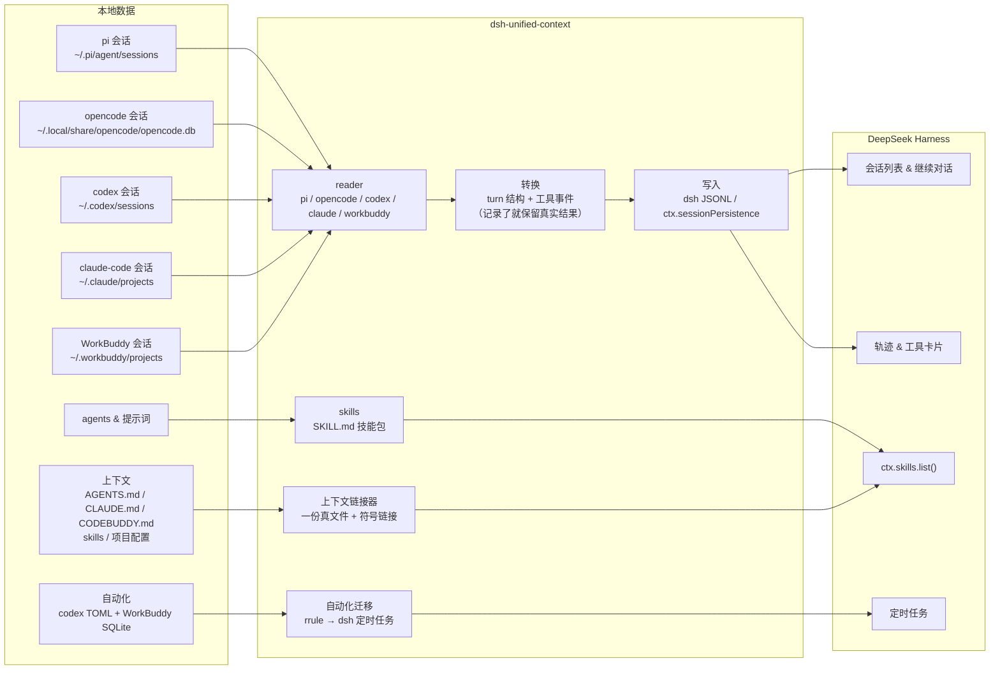

<!--
dsh-unified-context — 以 MIT License 发布。
-->
# DSH Unified Context

[English](README.md) · **简体中文**

[](LICENSE)
[](https://www.npmjs.com/package/dsh-unified-context)
[](https://github.com/Chang-Tong/dsh-unified-context/actions/workflows/ci.yml)
[](https://nodejs.org/)
[](https://dshoneys.github.io/awesome-dshoneys/)

**DSH Unified Context**（`dsh-unified-context`，统一上下文）把 **pi**、**opencode**、**codex**、**claude-code** 与 **WorkBuddy（腾讯）** 迁移进 [DeepSeek Harness](https://github.com/deepseek-ai/deepseek-harness)（dsh）：会话与聊天记录、模型真正看到的完整上下文（`AGENTS.md` / `CLAUDE.md` / `CODEBUDDY.md`、skills、项目与 Agent 长期记忆、项目配置），以及定时自动化任务。上下文用**符号链接共享同一份真文件**——不是每个 Harness 各复制一份。导入的会话出现在会话列表、可携带完整历史继续对话；自定义 agent 与模式提示词变成可发现的 dsh skills；composer 里的一键 **同步** 按钮即可完成全部迁移。

| 资源 | 链接 |
| --- | --- |
| English README | [README.md](README.md) |
| npm 包 | [dsh-unified-context](https://www.npmjs.com/package/dsh-unified-context) |
| 源码 | [github.com/Chang-Tong/dsh-unified-context](https://github.com/Chang-Tong/dsh-unified-context) |

## 目录

- [特性](#特性)
- [为什么需要统一上下文](#为什么需要统一上下文)
- [截图](#截图)
- [安装](#安装)
- [使用](#使用)
- [工作原理](#工作原理)
- [上下文一致性](#上下文一致性)
- [长期记忆](#长期记忆)
- [自动化任务](#自动化任务)
- [配置](#配置)
- [测试](#测试)
- [常见问题](#常见问题)
- [License](#license)

## 特性

- **五种来源，一条命令。** 导入 pi（JSONL）、opencode（SQLite）、codex（JSONL）、claude-code（JSONL）、WorkBuddy（JSONL）的会话——都是真实、可继续的 dsh 会话。
- **真正可继续。** 可浏览原始完整历史（文本、推理、工具调用——源格式记录了结果时连真实工具结果一起保留），并接着上次继续对话；模型拿到完整上下文。
- **上下文一致，不是复制。** `/link-context` 让所有 Harness 通过符号链接读同一份 `AGENTS.md`/`CLAUDE.md`/`CODEBUDDY.md` 和同一个 skill hub：只有一份真文件，不在每个 Harness 各存一份；有差异的副本会被报告出来而不是覆盖。
- **长期记忆，按项目 + 按 Agent。** 项目记忆（Claude Code / WorkBuddy）统一到 `<项目>/.agents/memory/`；agent 记忆（Codex 布局）统一到 `~/.agents/agent-memory/<agent>/`。默认 **authority**（以某个 Harness 为准，其余变链接），可 opt-in **merge**（生成引用索引、不复制笔记）。项目 `AGENTS.md` 里会生成一小段索引指向记忆文件，dsh 按需读取，不把全部笔记塞进上下文。
- **自动化任务也能迁移。** Codex automations 与 WorkBuddy automations 变成 dsh 定时任务（RRULE 翻译、默认以暂停状态导入，便于先停掉源任务）。
- **Agents 变成 skills。** pi 的 agent / 模式提示词与 opencode 的 agent 转成 `$DSH_AGENTS_HOME/skills` 下的技能包，frontmatter 记录来源（`metadata.source` / `metadata.kind`）。
- **一键同步按钮。** composer 工具行常驻一个小按钮，点击执行 `/import-all`，结果内联显示——会话、skills、上下文链接、暂停状态的自动化任务一次完成。
- **新会话主动询问迁移。** 新顶层会话启动时，若有未导入历史会自动询问是否迁移；按项目记住决定，绝不重复打扰。
- **按工作区分组。** 导入的会话自动挂到与原始 `cwd` 匹配的工作区（没有则创建）；`/attach-workspaces` 可补挂旧导入。
- **幂等。** 会话 id 稳定（`pi-<uuid>` / `oc-<id>` / `codex-<id>` / `claude-<id>`），重复导入自动跳过。
- **零运行时依赖。** 只用 Node 内置模块（`node:zlib` 的 zstd、`node:sqlite`）加 dsh 平台模块。

## 为什么需要统一上下文

每个 Harness 对「模型的上下文存在哪」都有自己的答案：聊天记录在一个地方，指令文件在另一个地方，skills 在第三个目录，长期记忆又换了格式，自动化任务干脆是另一套。于是换 Harness 时，模型不是变笨了，而是**失忆了**——它知道的东西有一半没跟过来。只导入聊天记录，大概只能补上一半的缺口。

DSH Unified Context 把剩下的补完：

- **一份会话。** 五种 Harness 的会话变成真正可继续的 dsh 会话——文本、推理、工具调用，以及源格式记录了真实结果时的工具结果。
- **一份指令。** `AGENTS.md` / `CLAUDE.md` / `CODEBUDDY.md` 收敛到一份规范文件，每个 Harness 通过符号链接读同样的字节。
- **一个技能架。** 一个共享 skill hub；只存在于某个 Harness 的技能原地收编，内容相同的副本折叠成链接。
- **一份记忆。** 项目记忆（Claude Code、WorkBuddy）与按 Agent 的记忆（Codex、Claude）按范围收敛到一份目录；在 `AGENTS.md` 里生成小索引，dsh 按需读取，不把笔记本塞满每次 prompt。
- **一套自动化。** Codex 与 WorkBuddy 的自动化变成 dsh 定时任务，默认暂停导入，方便先关掉源任务再启用。

真正让它可信的设计是：**链接，不是复制。** 每块共享内容只有一份真副本，其余全部指向它。在任何 Harness 里改一处，所有 Harness 立刻看到；不用手动重同步，也不会悄悄分叉。重跑是空操作；有差异的副本只报告、不覆盖；删掉软链接就能恢复原来的布局。

迁移应该像住进一间配好家具的房子，而不是重新买一遍家具。

## 截图

> 截取自干净的 Docker 演示环境（英文界面），内含示例 pi / codex 会话。

带 **同步** 按钮的 dsh web 主界面（composer 工具行）：


点击 **同步** 即执行完整导入，结果内联展示：


导入的会话按原始项目目录挂到对应工作区，标题带来源标签（`[pi]`、`[opencode]`、`[codex]` …）：


导入的会话打开后与原生 dsh 会话一致——文本、推理、工具调用完整保留，还能接着聊：


工具调用完整保留为真实轨迹条目——**Trajectory** 标签页为每次调用渲染卡片（下图是导入的 codex 会话中的一次 `bash` 调用）：


## 安装

插件已发布到 **npm**：`dsh-unified-context`，并声明了 `dsh.bundle`——官方一键安装命令会自动把它激活到 profile 里，无需手动配置。旧的 `dsh-import-agents` 包（0.3.1）仍可供旧 checkout 使用。

### 一键安装（推荐）

```sh
dsh plugin --profile web add dsh-unified-context
```

`dsh plugin add` 会安装包**并自动追加到 profile 的 bundle 列表**（层直接激活，无需手动配置）。之后重启 `dsh web` 并刷新页面即可。

> `dsh plugin --profile <名字>` 后面可以跟任意 pnpm 子命令——例如 `dsh plugin --profile web remove dsh-unified-context` 卸载。

### 安装源（spec）

`<spec>` 参数就是标准的 pnpm 包 spec：

| 来源 | 命令 |
| --- | --- |
| npm（最新版） | `dsh plugin --profile web add dsh-unified-context` |
| npm（指定版本/范围） | `dsh plugin --profile web add dsh-unified-context@0.5.0` · `@^0.5` |
| GitHub（短格式） | `dsh plugin --profile web add github:Chang-Tong/dsh-unified-context` |
| GitHub（锁定 commit） | `dsh plugin --profile web add github:Chang-Tong/dsh-unified-context#<sha>` |
| Git 完整地址 | `dsh plugin --profile web add git+https://github.com/Chang-Tong/dsh-unified-context.git` · `#v0.5.0` |
| 本地 checkout | `cd <目录> && dsh plugin --profile web add .` 或 `file:/路径/dsh-unified-context` |
| 开发链接 | `dsh plugin --profile web add link:/路径/dsh-unified-context` |
| tarball | `dsh plugin --profile web add ./dsh-unified-context-0.2.4.tgz`（或 `https://…` 地址） |

注意事项：

- 相对路径 spec（`.`、`../插件` 及其 `file:` / `link:` 形式）**锚定到调用目录**——在插件 checkout 目录里执行 `add .` 安装的就是当前这个 checkout。
- 从 Git 安装带源码的插件时，安装过程会跑 `prepare` 脚本构建；pnpm ≥ 10 默认阻止脚本，直到在 profile 的 `pnpm-workspace.yaml` 里允许：第一次 `add` 会失败并给出 `allowBuilds` 提示，把提示的 key 复制进去再跑一次即可。**安装构建好的 tarball 或本地 checkout 不需要这步**。
- 每次安装后，声明了 `dsh.bundle` 的依赖会自动加入层栈（自动激活）；没声明 `dsh.bundle` 的包只作为普通依赖安装（会打印一次性警告）。

### 重启并验证

1. 重启 `dsh web`——主机插件在启动时注册斜杠命令；前端产物（同步按钮）由 dsh web 自动加载。
2. **刷新页面**——重启后旧页面的 RPC 连接已断开。
3. 确认生效：输入框工具行出现 **同步** 按钮，输入 `/import-all` 有响应。

```sh
# 可选的自检命令
npm view dsh-unified-context version     # 查看最新发布版本
pnpm list dsh-unified-context            # 确认已装进 profile
```

> 想关闭「新会话主动询问迁移」：在插入行上写 `config: { offerOnStart: false }`。源路径与默认值同样可在此覆盖，见 [配置](#配置)。

## 使用

### 快速开始

1. **重启后刷新页面**。
2. 点 composer 工具行里的 **同步** 按钮，或直接输入 `/import-all`。这会执行完整迁移：五种来源的会话、agent → skills、共享上下文链接、以及暂停状态的自动化任务。
3. 导入的会话出现在会话列表（按工作区分组）；导入的 agent 变成可用的 skills；Automation tasks 页面能看到迁移过来的任务（**默认暂停**——先停掉源 harness 里的自动化，再在 dsh 里恢复）。

一切**幂等**——想跑多少次都行，已导入的会跳过、已有链接会复用、相同的自动化任务不会重复创建。

### 斜杠命令

| 命令 | 作用 |
| --- | --- |
| `/import-pi [选项]` | 导入 pi 会话 |
| `/import-opencode [选项]` | 导入 opencode 会话 |
| `/import-codex [选项]` | 导入 codex 会话 |
| `/import-claude-code [选项]` | 导入 claude-code 会话 |
| `/import-workbuddy [选项]` | 导入 WorkBuddy 会话 |
| `/import-agents` | 把 pi/opencode 的 agent 与模式提示词导入为 skills |
| `/link-context [--project DIR] [--dry-run] [--push] [--memory=authority\|merge\|off] [--authority=harness]` | 用符号链接让各 Harness 共享同一份 `AGENTS.md`/`CLAUDE.md`/`CODEBUDDY.md`、skill hub 与长期记忆（不复制） |
| `/import-automations [--only id] [--activate] [--dry-run]` | 把 Codex / WorkBuddy 自动化迁移为 dsh 定时任务（默认暂停） |
| `/import-all [选项]` | 以上全部（5 个会话来源 + agents + 上下文链接 + 暂停的自动化） |
| `/attach-workspaces` | 把已导入会话挂到 cwd 匹配的工作区（补挂旧导入） |

选项：`--limit N` · `--project 子串` · `--since ISO|ms` · `--no-tools` · `--tools-as-text` · `--tool-truncate N` · `--context-project DIR` · `--push` · `--activate`

### CLI（不需要 dsh）

```sh
node import.mjs all                    # dry-run 预览（不写任何东西）
node import.mjs all --apply            # 会话 + skills + 共享上下文链接
node import.mjs sessions codex --apply --limit 20      # 只导入单个来源
node import.mjs sessions workbuddy --apply             # 导入 WorkBuddy 会话
node import.mjs agents --apply         # 只导入 agents/提示词 → skills
node import.mjs context --apply        # 共享 AGENTS.md/CLAUDE.md/CODEBUDDY.md + skills
node import.mjs context --push --apply # 同时把 hub 技能反向链接到各 Harness 根
node import.mjs context --project-dir ~/work/app --apply # 项目级上下文统一
node import.mjs context --memory=merge --apply           # 生成合并记忆索引（引用，不复制）
node import.mjs context --authority=workbuddy --apply    # 指定以哪个 Harness 的记忆为准
node import.mjs automations            # Codex/WorkBuddy 自动化迁移计划（默认暂停）
node export.mjs                        # 把会话导出为 Markdown，供任意 agent 阅读
```

- `import.mjs` 默认 **dry-run**；加 `--apply` 才写入。
- `all` = **五种会话来源 + agents + 上下文链接**（`--apply` 时写入）+ 自动化**计划**。真正创建定时任务需要运行中的 dsh，请用 `/import-automations`。
- `context` 只建链接、不复制：重复运行是空操作；有差异的副本会报告为冲突并保持原样；`--push` 才开启双向技能共享。
- `export.mjs` 输出到 `$DSH_HOME/exports/<来源>/<会话id>.md`（支持 `--source`、`--project`、`--limit`、`--since`、`--out`、`--no-reasoning`、`--no-tools`）。

## 工作原理



导入器本质是一个纯转换器：`lib/` 把各来源解析成归一化消息流，再输出与 dsh 完全一致的 JSONL 事件布局（带校验和的 zstd 帧、项目目录编码）——dsh 自带的 `list` / `load` / `prepare` 可以逐字节读回。

**会话（聊天记录）。** 每条 user 消息开启一个 turn（`turn/start` + `user/message`），随后的 assistant 消息以递增 step 加入同一 turn，turn 以 `turn/end` 收尾。pi 的 `thinking` → dsh 的 `reasoning` 块；pi `toolCall` / opencode `tool` / claude `tool_use` / codex `tool_use` / WorkBuddy `function_call` → `tool-call` 内容块 **并配套写入 `tool/call` + `tool/result` 事件**：轨迹视图渲染工具卡片，`tool/result` 让恢复会话时每个 `tool_calls` 都有应答（OpenAI 兼容 API 会拒绝孤立的 `tool_calls`）。WorkBuddy 还保存了真实结果（`function_call_result`），会原样保留；其他来源只有调用，所以它们的 `tool/result` 是明确标注的占位文本。WorkBuddy 注入的 `<system-reminder>` 上下文会被剥离，只导入真正的 `<user_query>` 用户消息。`--tools-as-text` 转成纯文本（无轨迹卡片）；`--no-tools` 完全丢弃。机械记录（`step-start`、`patch`、`compaction` 等）跳过。

**agents / 提示词 → skills。** 写入 `$DSH_AGENTS_HOME/skills/<名称>/SKILL.md`（默认 `~/.agents/skills/`），`ctx.skills.list()` 即可发现。名称冲突自动改名 `<名称>-<来源>`（如 `k3-reviewer-opencode`）；已存在的 bundle 只补 `SKILL.md` 不动其他文件；同名同内容自动跳过；frontmatter 记录 `metadata.source` / `metadata.kind` 溯源。

**上下文。** 指令文件与 skills 不做格式转换，而是**链接**到唯一一份真文件（见[上下文一致性](#上下文一致性)）——迁移不会在每个 Harness 的工作区里再写一份副本。

**自动化任务。** Codex 的 `automation.toml` 与 WorkBuddy 的 automations SQLite 库会被规划成 dsh 定时任务（见[自动化任务](#自动化任务)）。

## 上下文一致性

切换 Harness 不应改变模型看到的东西。聊天记录只是上下文的一层；导入器把其余部分也迁移过来，而且用链接而不是复制：

| 上下文层 | 是什么 | 迁移方式 |
| --- | --- | --- |
| 会话 | 用户/助手消息、推理、工具调用、工具结果 | 导入为 dsh 会话（源记录了真实结果就保留） |
| 指令 | `AGENTS.md`、`CLAUDE.md`、`CODEBUDDY.md`——全局与项目级 | 一份规范文件；各 Harness 的读取路径都是指向它的符号链接 |
| Skills | `<名称>/SKILL.md` 技能包与扁平 `<名称>.md` 技能 | 一个共享 hub（`~/.agents/skills`）；只在某个 Harness 存在的技能用链接收编，内容相同的副本改成链接 |
| 项目配置 | `opencode.json`、`.claude/settings.json`、`.pi/settings.json`、`.codex/config.toml`、`.workbuddy/settings.json` 等 | **从不复制**：每个 Harness 打开的是同一个项目目录，文件本来就留在原地（格式仍由各 Harness 各自解释） |

各 Harness 从哪里读上下文：

| Harness | 全局指令 | 全局 skills | 项目指令 | 项目 skills |
| --- | --- | --- | --- | --- |
| dsh | `$DSH_HOME/AGENTS.md` | `~/.agents/skills`（hub） | `AGENTS.md` / `CLAUDE.md` | `.agents/skills` |
| codex | `~/.codex/AGENTS.md` | `~/.codex/skills` | `AGENTS.md` | `.codex/skills` |
| claude-code | `~/.claude/CLAUDE.md` | `~/.claude/skills` | `CLAUDE.md` | `.claude/skills` |
| pi | `~/.pi/agent/AGENTS.md` | `~/.pi/agent/skills` | `AGENTS.md` / `CLAUDE.md` | `.pi/skills` |
| opencode | `~/.config/opencode/AGENTS.md` | `~/.config/opencode/skills`（同时读 `~/.agents/skills` 与 `~/.claude/skills`） | `AGENTS.md` | `.opencode/skills` |
| WorkBuddy | 身份文件 `SOUL.md` / `IDENTITY.md` / `USER.md` / `MEMORY.md`（Harness 原生，不统一） | `~/.workbuddy/skills` | `CODEBUDDY.md` / `.codebuddy/CODEBUDDY.md` / `AGENTS.md` | `.workbuddy/skills` / `.codebuddy/skills` |

链接器的规则：

- **每个名字只有一份真文件。** 全局上下文的 hub 在 `~/.agents`，项目上下文在 `<项目>/.agents/skills`；各 Harness 的读取路径变成指向它的相对符号链接。
- **绝不覆盖差异。** 内容相同的文件/副本会被替换成链接（内容不变）；内容不同的副本列为冲突并保持原样——手动合并后重跑即可。
- **默认只汇入（pull-only）。** 每个 Harness 把自己的 skills 汇入 dsh 读取的 hub，迁移后的会话就能看到并集；`--push` 额外把 hub 技能反向链接到每个 Harness 根（opencode 除外：它本来就读 `~/.agents/skills`，再推会重复加载）。
- **幂等且可回退。** 重跑只补缺失链接；删掉符号链接就恢复原来的单 Harness 文件。
- **项目级**（`--project DIR` / `--context-project DIR`，默认当前会话目录）统一 `AGENTS.md` / `CLAUDE.md` / `CODEBUDDY.md`，并收敛 `.agents` / `.claude` / `.codex` / `.pi` / `.workbuddy` 项目技能根；不会为项目里没用到的 Harness 凭空创建目录。
- **不统一的部分：** WorkBuddy 的全局身份/记忆文件（dsh 没有对应的单文件机制）、MCP 服务器定义、provider/模型与权限配置——这些保持各 Harness 原生，[常见问题](#常见问题)里明确说明。

在 GUI 里用 `/link-context`（`--dry-run` 只预览），或在 CLI 用 `node import.mjs context [--apply] [--push] [--project-dir DIR]`。

### 长期记忆

记忆是独立的上下文层，分两个范围：

| 范围 | 原生来源 | 统一存放位置 |
| --- | --- | --- |
| 项目 | Claude Code `~/.claude/projects/<编码>/memory/`；WorkBuddy `<项目>/.workbuddy/memory/` | `<项目>/.agents/memory/` |
| Agent | Codex `~/.codex/agent-memory/<agent>/`；Claude Code `~/.claude/agent-memory/<agent>/`（按 Agent，参照 Codex 布局） | `~/.agents/agent-memory/<agent>/` |

`--memory` 策略：

- **`authority`（默认）**——选一个真目录为准（项目：Claude → WorkBuddy；Agent：Codex → Claude，可用 `--authority=<harness>` 覆盖），其他 Harness 的路径变软链接；内容不同且非空的记忆报告为冲突、保持原样，不自动合并。
- **`merge`**——`<项目>/.agents/memory/MEMORY.md` 变成生成的索引，**原地引用**各 Harness 的记忆笔记（绝对路径，不复制），不替换任何目录。Agent 记忆仍走 authority。
- **`off`**——不动记忆。

dsh 没有独立记忆读取器，所以在项目 `AGENTS.md`（所有 Harness 共享的那份）里生成一小段带标记的索引（`<!-- dsh-unified-context:memory:begin -->`）指向 `.agents/memory/`，笔记按需读取，不往每次 prompt 里塞。标记块之外的内容绝不修改。

Codex 的 `agent-memory` 是**按 Agent 而不是按项目**的，所以它统一到 `~/.agents/agent-memory/<agent>/`，不并入项目记忆。整个记忆层幂等、可 `--memory=off` 关闭。

## 自动化任务

定时任务也能迁移：

| 来源 | 位置 | 映射 |
| --- | --- | --- |
| Codex | `~/.codex/automations/<id>/automation.toml` | `name` → 任务标题，`prompt` 原样，`rrule` → `DTSTART;TZID=Asia/Shanghai` + `RRULE`；目标：`cron` → 在记录的 `cwds[0]` 里新开对话；`heartbeat` → 已导入的 Codex 会话（`codex-<thread-id>`），不存在则复用一个新对话 |
| WorkBuddy | `~/Library/Application Support/WorkBuddy/automations/automations.db` | recurring 行 → 在记录的 cwd 里新开对话；模型、微信推送、技能选择不迁移 |

默认**以暂停状态导入**：先暂停（或删除）来源自动化，再在 Automation tasks 页面恢复 dsh 任务；`/import-automations --activate` 可直接激活活跃来源。恢复前请核对翻译后的时间表——参考时间是导入后的下一次触发，而不是原始创建时间（对 `INTERVAL>1` 的规则有影响）。

不迁移：来源的模型与推理强度（定时会话使用 dsh preset 默认值）、通知策略 / 微信推送、单任务技能选择、历史运行记录。`node import.mjs automations` 只打印计划；真正创建任务需要运行中的 dsh（`/import-automations`）。

## 配置

| 键 | 默认值 | 含义 |
| --- | --- | --- |
| `offerOnStart` | `true` | 新顶层会话启动时是否询问迁移 |
| `piRoot` | `~/.pi/agent/sessions` | pi 会话根目录 |
| `piAgentRoot` | `~/.pi/agent` | pi agents / 提示词根目录 |
| `opencodeDb` | `~/.local/share/opencode/opencode.db` | opencode SQLite 路径 |
| `opencodeConfig` | `~/.config/opencode` | opencode agents 根目录 |
| `codexRoot` | `~/.codex/sessions` | codex 会话根目录 |
| `claudeRoot` | `~/.claude/projects` | claude-code 项目根目录 |
| `workbuddyRoot` | `~/.workbuddy` | WorkBuddy 数据根目录（会话、skills） |
| `workbuddyAutomationsDb` | `~/Library/Application Support/WorkBuddy/automations/automations.db` | WorkBuddy 自动化 SQLite 库 |
| `codexHome` | `~/.codex` | Codex 配置根目录（从这里的 `automations/` 读取） |
| `timeZone` | `Asia/Shanghai` | 翻译自动化 RRULE 时使用的时区 |
| `skillsRoot` | `$DSH_AGENTS_HOME/skills` | skills 输出根目录 |
| `toolTruncate` | `1000` | 工具调用参数截断长度（字符） |

迁移询问只对**全新顶层**会话（startup、非 subagent）且带 `cwd`、存在未导入历史时触发。每个项目的决定与全局 agents 决定记录在 `$DSH_HOME/unified-context-state.json`；headless 等无 UI provider 的环境自动静默跳过。

## 测试

- `verify.mts` — 在 staging 目录上用**真实** dsh JSONL 后端 + skill provider 读回导入产物（在 dsh 仓库根执行 `node --import tsx/esm ../dsh-unified-context/verify.mts <sessions根> <skills根>`）→ 期望输出 `SESSIONS ALL PASS / SKILLS ALL PASS`。
- `plugin/plugin-test.mts` — 端到端：在真实 cordis 上下文加载插件，跑命令与新会话迁移询问，断言幂等与状态持久化。
- `scripts/e2e-commands.mjs` — 新命令的端到端手测：在真实 cordis 命令运行时挂载插件，调用 `/link-context`（隔离 HOME 里真实应用 + 真 HOME dry-run）与 `/import-automations`（内存 schedule：创建为暂停，重跑 created 0 / skipped 11）。
- `tests/` — Vitest：同步按钮（`sync-button.spec.tsx`、`sync-button-hide.spec.tsx`）、reader（`opencode-reader.spec.ts`、`workbuddy-reader.spec.ts`）、上下文链接器（`context.spec.ts`）、记忆层（`memory.spec.ts`）、自动化（`automations.spec.ts`、`workbuddy-automations.spec.ts`）、真实工具结果转换（`convert-tool-result.spec.ts`）与 `attach-workspaces.spec.ts`。
- CI（GitHub Actions，`macos-latest`，Node 22）：`pnpm install` → `pnpm run build` → `npx vitest run`。

```sh
pnpm install          # devDependencies（esbuild、vitest）
pnpm run build        # 重建 lib/client.js（同步按钮 bundle）
npx vitest run        # 组件测试
```

## 常见问题

**为什么点同步显示「新导入 0，已存在跳过 N」？**
这正是幂等性在工作：这些会话之前已导入，所以跳过，不会产生重复。

**工具调用的结果为什么没有？**
pi、opencode、codex、claude-code 只保存调用，所以它们的导入把调用保留为 `tool-call` 块并配套明确标注的占位 `tool/result`（轨迹照常渲染卡片，恢复会话时请求合法）。WorkBuddy 保存了真实结果，会原样导入。

**上下文迁移会把文件复制到每个 Harness 吗？**
不会。`/link-context` 只建一份真文件 + 符号链接；已存在且内容相同的副本会被替换成链接，内容不同的副本报告为冲突并保持原样，绝不覆盖。默认只汇入（pull-only）；`--push` 才把 hub 技能反向链接到每个 Harness 根。

**迁移过来的自动化为什么是暂停的？**
避免来源自动化（Codex/WorkBuddy）还在运行时重复执行。先在来源里暂停或删除，再在 dsh 恢复任务；如果已经停掉来源，可以用 `--activate` 跳过暂停默认值。

**WorkBuddy 的 `SOUL.md` / `MEMORY.md` 会迁移吗？**
不会并入共享指令文件：它们是 WorkBuddy 原生的身份/记忆文件，dsh 没有对应的单文件机制，继续留在 WorkBuddy 读取的位置。WorkBuddy 的 **skills** 与项目 `CODEBUDDY.md` 属于共享上下文。

**会不会一直问我迁移？**
只在存在未导入会话时问，且按项目记忆。选了「不导入」或导入完成后，决定写入 `$DSH_HOME/unified-context-state.json`，不再打扰。

**为什么 dsh 重启后必须刷新页面？**
重启后旧页面的 RPC 连接已断开，未刷新时点同步或任何命令都会失败。

**Node 版本要求？**
Node ≥ 22.19——与 dsh 一致（`node:sqlite`、`node:zlib` 的 zstd）。

## License

MIT——见 [LICENSE](LICENSE)。
